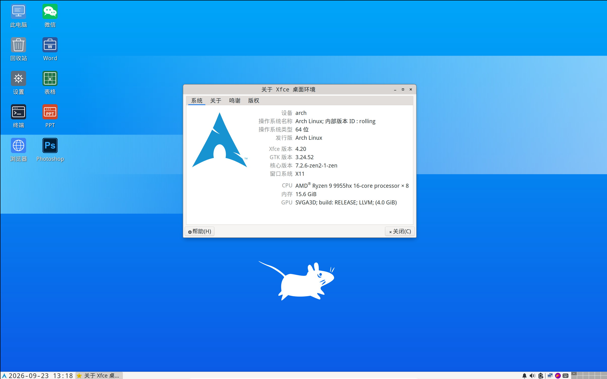

# Arch Installer

近几年 [ArchISO] 体积增长了 1GB 多，功能却没有什么显著变化，反而多次变更 vmlinuz 和
initrd 路径造成启动失败。

遂以自己本地稳定运行 **五年+** 的 [Arch Linux] + [Xfce4] 桌面系统为蓝本，制作了一个镜像。
在保证轻量、美观的前提下，尽可能包含更多的维护工具。

既可用于日常轻办公，也能替代 [ArchISO] 用作 Live 维护系统。

[Arch Linux]: https://archlinux.org/
[ArchISO]: https://archlinux.org/download/
[Xfce4]: https://wiki.archlinux.org/title/Xfce

## 特性

- 完全中文本地化 + 易操作的图形化界面 (X11 + Xfce4)。
- 精选各类轻量级软件，在不增大镜像体积的情况下可日常轻办公。
- 包含引导、性能、磁盘、网络、日志... 等各种排障工具。
- 系统各组件能自适应不同的分辨率。
- 等你发现...



## 启动镜像

大致有两种方式启动镜像。

#### 1. 独占 U 盘: dd (Linux / macOS)、Rufus (Windows)

```Bash
# dd (Linux / macOS):
dd if=/path/to/iso of=/dev/your-usb-device bs=32M status=progress
```

#### 2. 非独占 U 盘: GRUB2 (Linux)、Ventoy (Windows)

```Bash
# GRUB2 (Linux):

# 1. 编辑 40_custom 文件
cp -a /etc/grub.d/40_custom /etc/grub.d/40_custom.bak
vim /etc/grub.d/40_custom

# 2. 添加如下内容 (假设 iso 放在 ESP 分区)
menuentry "[+] Arch Linux LiveCD" {
    search --no-floppy --label Your-ESP-Label --set=root
    set isofile="/path/to/archlinux-live-xxxxxxxx.iso"
    loopback loop $isofile

    set vmpath=/arch/boot/x86_64/vmlinuz-linux-zen
    set imgdevpath=/dev/disk/by-label/Your-ESP-Label
    linux (loop)$vmpath rw sysrq_always_enabled=1 img_dev=$imgdevpath img_loop=$isofile earlymodules=loop
    initrd (loop)/arch/boot/x86_64/initramfs-linux-zen.img
}

# 3. 重新生成 grub.cfg
grub-mkconfig -o /boot/grub/grub.cfg
```

## 安装 Arch Linux

#### 1. 你可以以此镜像为基础继续使用

```Bash
# 1. 硬盘分区
parted -s --align optimal /dev/nvme0n1 mklabel gpt
parted -s --align optimal /dev/nvme0n1 mkpart 1 0% 2GiB
parted -s --align optimal /dev/nvme0n1 mkpart 2 2GiB 100%

# 2. 文件系统与挂载
mkfs.fat -F 32 /dev/nvme0n1p1
mkfs.ext4 /dev/nvme0n1p2

mount /dev/nvme0n1p2 /mnt
mkdir -p /mnt/boot/esp
mount /dev/nvme0n1p1 /mnt/boot/esp

# 3. 全量复制系统文件
rsync -aAXHS --numeric-ids --info=PROGRESS2 --human-readable / /mnt

# 4. 生成 fstab
genfstab -U /mnt > /mnt/etc/fstab

# 5. 生成 initramfs / UKI
arch-chroot /mnt
mkinitcpio -P

# 6. 其它

# 重建 pacman 密钥环
pacman-key --init
pacman-key --populate
```

#### 2. 全新安装 Arch Linux

从 [Releases] 下载并启动 Live 镜像，点击桌面 **Installer** 图标按照操作提示可指导你完成安装。

[Releases]: https://github.com/kitty-panics/arch-installer/releases

## 使用

### 1. 快捷键

#### Xfce

#### Ranger

#### Chromium

已安装 [Vimium] 插件，可以使用 Vim 风格的键盘快捷键进行网页浏览和标签页管理。

[Vimium]: https://github.com/philc/vimium

#### Vim

> `<leader>` 默认为空格键。

| 快捷键 | 模式 | 功能 |
|--------|------|------|
| `;` | 普通模式 | 进入命令模式（等同于 `:`） |
| `H` | 普通模式 / 可视模式 / 操作符模式 | 跳到行首非空字符 |
| `L` | 普通模式 / 可视模式 / 操作符模式 | 跳到行尾非空字符 |
| `j` | 普通模式 | 下移并保持光标居中 |
| `k` | 普通模式 | 上移并保持光标居中 |
| `gg` | 普通模式 | 跳到文件头并保持光标居中 |
| `G` | 普通模式 | 跳到文件尾并保持光标居中 |
| `n` | 普通模式 | 下一个搜索匹配并保持光标居中 |
| `N` | 普通模式 | 上一个搜索匹配并保持光标居中 |
| `*` | 普通模式 | 搜索当前词并保持光标居中 |
| `#` | 普通模式 | 反向搜索当前词并保持光标居中 |
| `Y` | 普通模式 | 从光标复制到行尾 |
| `<leader>w` | 普通模式 | 保存 |
| `<leader>q` | 普通模式 | 退出 |
| `<leader>x` | 普通模式 | 保存并退出 |
| `Ctrl + k` | 普通模式 / 可视模式 / 操作符模式 | 切换到上方窗口 |
| `Ctrl + j` | 普通模式 / 可视模式 / 操作符模式 | 切换到下方窗口 |
| `Ctrl + h` | 普通模式 / 可视模式 / 操作符模式 | 切换到左侧窗口 |
| `Ctrl + l` | 普通模式 / 可视模式 / 操作符模式 | 切换到右侧窗口 |
| `<leader>tc` | 普通模式 / 可视模式 / 操作符模式 | 新建 Tab |
| `<leader>tq` | 普通模式 / 可视模式 / 操作符模式 | 关闭 Tab |
| `<leader>tn` | 普通模式 / 可视模式 / 操作符模式 | 下一个 Tab |
| `<leader>tp` | 普通模式 / 可视模式 / 操作符模式 | 上一个 Tab |
| `]t` | 普通模式 | 下一个 Tab |
| `[t` | 普通模式 | 上一个 Tab |
| `<leader>1` ~ `<leader>9` | 普通模式 / 可视模式 / 操作符模式 | 切换到第 1~9 个 Tab |
| `<leader>0` | 普通模式 / 可视模式 / 操作符模式 | 切换到第 10 个 Tab |
| `]b` | 普通模式 | 下一个 Buffer |
| `[b` | 普通模式 | 上一个 Buffer |
| `Ctrl + a` | 插入模式 / 命令模式 | 跳到行首 |
| `Ctrl + e` | 插入模式 / 命令模式 | 跳到行尾 |
| `Ctrl + d` | 插入模式 / 命令模式 | 删除当前字符 |
| `Ctrl + b` | 命令模式 | 左移 |
| `Ctrl + f` | 命令模式 | 右移 |
| `Ctrl + h` | 插入模式 / 命令模式 | 左移 |
| `Ctrl + j` | 插入模式 / 命令模式 | 下移 |
| `Ctrl + k` | 插入模式 / 命令模式 | 上移 |
| `Ctrl + l` | 插入模式 / 命令模式 | 右移 |
| `Ctrl + p` | 命令模式 | 上一条命令历史 |
| `Ctrl + n` | 命令模式 | 下一条命令历史 |

## 旧版

> 由于 Arch 官方时不时要变动一下安装流程，旧版安装脚本不再维护。

一键安装全局 LUKS 加密的 Arch Linux 系统。

#### 使用

如果你还想继续使用，执行下面的命令即可安装 Arch Linux 系统。

```Bash
bash <(curl -sL https://raw.githubusercontent.com/kitty-panics/arch-installer/master/bin/setup.sh)
```

**备注：**

执行这条命令前，请确认你的设备满足以下条件。

- 设备处于一个 ``高速且稳定`` 的网络环境中。
- 设备中的 ``重要文件`` 已备份。
- 仔细阅读安装脚本中的提示信息。

## 许可证

[MIT](../LICENSE)
